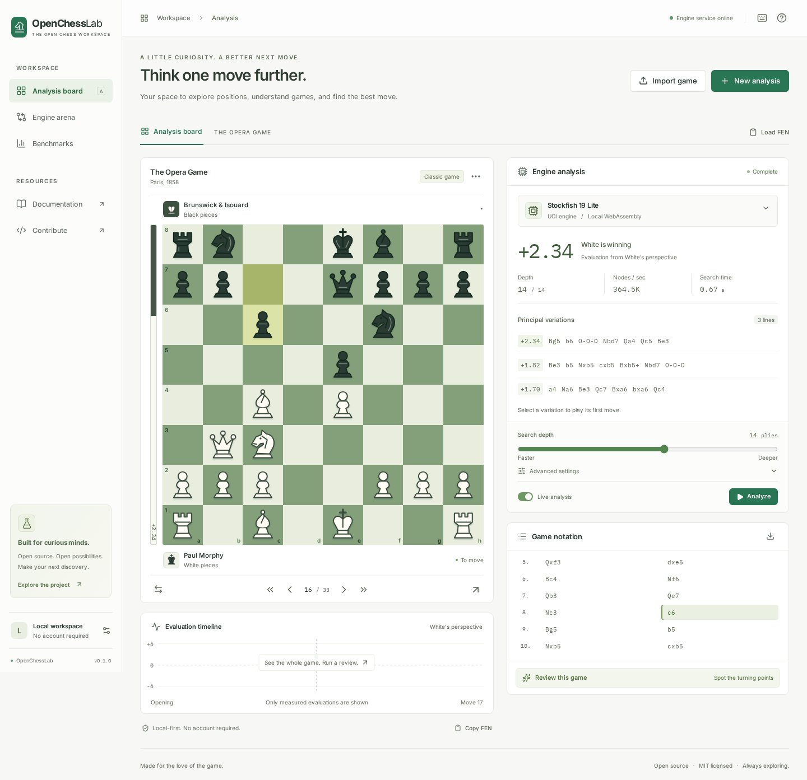

# OpenChessLab

Open-source chess analysis with Stockfish, PGN/FEN support, game reviews, UCI engine comparisons, and performance benchmarks.

**Think one move further.**

A local-first, open-source workspace for chess analysis and UCI engine experimentation. Explore a game on an interactive board, inspect Stockfish's principal variations, find turning points, and compare engines using measurements from your own machine.

OpenChessLab is for chess enthusiasts who want to understand a position, developers building UCI engines, and researchers who need transparent, exportable experiments. No account, telemetry, external analysis service, or fabricated performance data.



[Mobile layout](docs/images/mobile.jpg) | [User guide](docs/usage.md) | [API reference](docs/api.md) | [Verification report](docs/verification.md)

Screenshots show actual runtime engine output, not seeded demo scores. Their incidental timings are not comparative benchmarks.

## Start Here

Requirements: **Node.js 22.12+, 24, or 26**, npm, and a modern browser. Node 24 is the default development/container runtime; CI covers all three supported major versions. The npm installation includes the separate Stockfish.js engine package; allow approximately 205 MB for that package alone.

```bash
git clone https://github.com/adibbanyasad-create/OpenChessLab.git
cd OpenChessLab
npm ci
npm run build
npm start
```

Open **http://127.0.0.1:3001**. The server binds to loopback by default. Stockfish 19 Lite is the default engine; full-network Stockfish 19 is also included. Both execute on the **server machine**, not inside the browser.

For development:

```bash
npm ci
npm run dev
```

Open **http://localhost:5173**. Vite proxies `/api` to the local engine service. See [installation](docs/installation.md) for configuration, containers, and troubleshooting.

## What You Can Do

- **Analyze a position:** import a single PGN game or a FEN, make legal moves, choose a promotion, and navigate the main line. Desktop drag-and-drop, touch selection, and keyboard controls are supported.
- **Inspect real engine output:** White-normalized evaluations, mate scores, up to five principal variations in SAN, depth, engine-reported nodes per second, and search time. Unreported measurements are shown as unavailable, not invented zeros.
- **Control the search:** depth 1-24, 1-4 threads, and 16-512 MB of hash. Unsupported engine options and time-limited searches are explicitly reported.
- **Review a game:** analyze consecutive positions, visualize an evaluation timeline, and flag estimated inaccuracies, mistakes, and blunders. Labels are heuristics, not an accuracy rating. Incomplete searches are marked uncertain with null losses, and reviews export to CSV/JSON.
- **Compare engines:** the same position, settings, and protocol, with both bundled engines or your own server-configured UCI executable. Centipawn-only agreement summaries show evaluation spreads without averaging mates into numeric scores.
- **Benchmark honestly:** sequential searches, per-position UCI state resets, environment metadata, measured search wall time, engine-reported nodes and NPS, custom FEN positions, and JSON/CSV exports. No scores appear until an experiment completes.
- **Prove it with bundles:** frozen Suite v1 positions with content hashes, tamper-evident `.oclb.json` experiment bundles, a standalone verifier, and a headless regression CLI with a copy-paste CI workflow for engine repos. See [reproducibility](docs/reproducibility.md).
- **Keep your work:** restore the active game and up to 20 validated benchmark records from browser storage. Historical rows retain the engine name/version actually reported during the run. Export PGN, FEN, JSON, and CSV; clear benchmark history independently of your game.

The [verification report](docs/verification.md) records observed checks and their scope, with earlier reports preserved separately. Current hosted checks are available in the repository's [Actions tab](https://github.com/adibbanyasad-create/OpenChessLab/actions). A passing workflow is not evidence of a production deployment.

Upgrading an API client? Read the [0.5 migration notes](docs/migration-0.5.md) and earlier migration guides: suite references and bundle exports are additive, and uncertain data remains explicit.

## A Deliberately Small Architecture

```text
React + TypeScript browser workspace
             |
       same-origin JSON API
             |
Fastify API + bounded in-memory job manager
             |
    allowlisted UCI subprocesses
             |
Stockfish 19 Lite / Stockfish 19 / your engine
```

The server owns engine execution, input validation, cancellation, deadlines, and concurrency. Chess rules and shared types live in `src/shared`. The browser never supplies executable paths or raw UCI commands. Engines run as separate processes and are terminated after each job.

```text
src/client/          React interface and original SVG chess pieces
src/server/          API, engine registry, UCI transport, jobs, tasks
src/shared/          Schemas, chess helpers, result types, CSV export
tests/unit/          Chess rules, schema, protocol, and lifecycle checks
tests/integration/   API and actual Stockfish integration tests
tests/e2e/           Chromium desktop and mobile browser tests
docs/                User, developer, API, and release documentation
.github/             CI, security, release workflows, contribution templates
```

Read the [architecture](docs/architecture.md), [API reference](docs/api.md), and [benchmarking methodology](docs/benchmarking.md).

## Bring Your Own Engine

Create a local engine registry based on `engines.example.json`. Only the server operator can add executables.

```json
[
  {
    "id": "my-engine",
    "name": "My research engine",
    "description": "A local UCI build",
    "command": "/absolute/path/to/engine",
    "args": []
  }
]
```

```bash
ENGINES_CONFIG=/absolute/path/to/engines.local.json npm start
```

Use PowerShell's `$env:ENGINES_CONFIG` on Windows. Custom engines must speak UCI on stdin/stdout. See [configuration](docs/configuration.md) for optional UCI settings and safety limits. Treat installed engines as trusted programs: process isolation is **not an operating-system sandbox**.

## Quality Checks

```bash
npm run lint
npm run typecheck
npm run docs:check
npm test
npm run test:coverage
npm run build
npx playwright install --with-deps chromium
npm run test:e2e
npm run security
```

The integration suite runs actual Stockfish searches. Browser tests exercise the production build and real API, including cancellation, restoration, keyboard controls, and accessibility checks. CI is configured for Node 22, 24, and 26, clean production-archive installation, and a container runtime check. Weekly regression, dependency-audit, and CodeQL workflows provide recurring checks. Dependency updates are proposed as reviewable PRs, not silently merged. A tag-driven release workflow creates a draft release archive and SHA-256 checksum after checks pass.

See the [maintenance guide](docs/maintenance.md) for what runs automatically, what still needs a maintainer, and how to handle failed checks. Automation does not guarantee continuous monitoring, safe automatic fixes, or security certification.

## Security and Privacy

This is a **single-user, local-first tool**, not an authenticated multi-tenant hosting platform. Default operation is on loopback. Host/origin checks, strict schemas, request limits, resource caps, UCI deadlines, and optional bearer authentication are included.

To use a private remote server, set `OPENCHESSLAB_API_TOKEN` (at least 24 characters), configure `ALLOWED_HOSTS`, use HTTPS, and protect access at the network boundary. Never expose an unauthenticated engine service to the public internet. Tokens are entered through Connection settings and kept in tab-scoped session storage.

Games are sent only to the configured same-origin server. Browser PGN state and benchmark history are not encrypted at rest. Saved benchmark history is bounded to 20 runs and 1 MB; storage failures fall back to the current session with a visible warning. Close other OpenChessLab tabs before clearing history. Completed server jobs expire after 30 minutes or a server restart, with at most 100 records retained. Read [SECURITY.md](SECURITY.md).

## Honest Limitations

- Standard chess and one PGN main line at a time. PGN comments/variations are not an editable variation tree.
- Review labels use centipawn-loss thresholds at finite depth. Mate values use a documented surrogate for classification. The UI reviews at up to depth 10; the API allows 14.
- Each search starts from FEN, so repetition history is not supplied to the engine. No opening database, cloud engine, Syzygy tablebase service, Elo estimate, or engine tournament scheduler.
- WASM full and Lite builds are not interchangeable. Lite uses a smaller, weaker neural network; neither is advertised as equivalent to a native CPU-specific build.
- Benchmark results depend on hardware, system load, runtime, engine build, threads, and time limits. NPS is not a playing-strength rating.
- No accounts, durable server database, arbitrary engine uploads, or public multi-user deployment configuration.

These are boundaries, not quietly stubbed features. See [the roadmap](docs/roadmap.md) for unimplemented ideas.

## Contribute and Publish

Small, focused contributions are welcome. Start with [CONTRIBUTING.md](CONTRIBUTING.md), the [Code of Conduct](CODE_OF_CONDUCT.md), and the [development guide](docs/development.md).

The public repository is [adibbanyasad-create/OpenChessLab](https://github.com/adibbanyasad-create/OpenChessLab). The [publication checklist](docs/publishing.md) covers repository settings, vulnerability reporting, and future releases. No community adoption or production deployment is claimed.

## License

OpenChessLab's original application code, documentation, and chess-piece artwork are **MIT licensed**; see [LICENSE](LICENSE).

**Stockfish is not MIT licensed.** The separately executed `stockfish` npm package includes GPL-3.0 engine code. Its source, license, and redistribution obligations remain applicable. Other third-party components retain their licenses. See [THIRD_PARTY_NOTICES.md](THIRD_PARTY_NOTICES.md) and the license inventory generated inside `dist` during a build.
